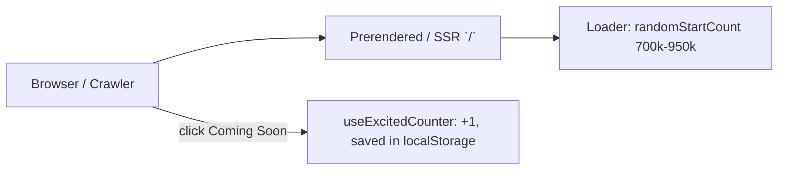

<p align="center">
  
</p>

<h1 align="center">⚛️ AtomIQ</h1>

<p align="center"><strong>Nuclear Science Is More Than You Think.</strong></p>
<p align="center">Making nuclear science clear, playful, and for everyone.</p>

<p align="center">
  
  
  
  
  </p>

<p align="center">
  <a href="#-quick-start">Quick Start</a> •
  <a href="#-sections">Sections</a> •
  <a href="#-tech-stack">Tech Stack</a> •
  <a href="#-architecture">Architecture</a> •
  <a href="#-environment">Environment</a> •
  <a href="#-project-structure">Structure</a>
</p>

---

> **AtomIQ** turns nuclear science into interactive lessons, games, challenges, and trusted references — so anyone can understand the science beyond the myths.

This repo is the **marketing landing page** for AtomIQ: a fast, SEO-first, fully SSR single-route site with a playful “excited clicks” counter that starts at a random 700,000–950,000.

---

## ✨ Highlights

| | |
|---|---|
| 🚀 **SEO-first SSR** | Full server render + prerendered `/` + ISR (`max-age=60, stale-while-revalidate=300`) |
| ⚡ **Instant counter** | No backend: starts at a random 700,000–950,000 (picked once by the route loader), every click adds one, and a visitor's total is kept in `localStorage` |
| 🛡️ **Never breaks SSR** | Custom 404 + error boundaries; no external services to fail |
| 🎨 **The app's own design system** | Intern font, white pages, 2 px borders with 4 px "lips", the yellow brand button, one colour per unit (tokens in `src/styles/variables.css`) |
| 👾 **Live Shrodi + real app art** | Shrodi is drawn and animated by the app's own code (blink, glance, breathing); teachers, phone icons and lesson objects are exported from the app (`scripts/export-art.mjs`) |
| 🧠 **Myth-busting quiz** | Myth vs. Fact challenge with explanations |
| 🤖 **Shrodi chat** | A tap-to-reply chat in the Phone's messenger look, with source-backed sample answers |
| 📚 **48+ curated sources** | Every discovery traces back to real research |
| ♿ **Accessible** | Semantic landmarks, `aria-live` counter, labeled CTAs, keyboard-friendly FAQ/modal |

---

## 🖥️ Sections

| Section | What it does |
|---|---|
| **Hero** | Headline stamped on a yellow chip, live-excited counter, Coming Soon CTA, a waving Shrodi on a lesson node with orbiting electrons and lesson objects (poke Shrodi to cheer) |
| **Introduction** (`#about`) | A phone tour that cycles four screens drawn in HTML from the app's tokens and art: map, lesson, feed, phone |
| **Explore** (`#features`) | Bento of 3D cards: lessons and the seven teachers, Myth Smashers, Atom Maze, AtomDex, avatar shop |
| **Shrodi chat** (`#shrodi`) | Tap a question, Shrodi types and answers with sources |
| **Challenge** (`#myth-smashers`) | Myth / Fact built like a lesson question: option pop, shake when wrong, feedback sheet |
| **Journey** (`#our-story`) | The team's story as a dotted road of lesson-map nodes |
| **Team** | Michelle Reyes (Research), Kent Garcia (Dev, lead), Ezekiel Pinto (Research) |
| **FAQ** | What is AtomIQ, who it's for, trust, Shrodi, availability |
| **Final CTA + Footer** | Second counter + CTA on the sky purple, copyright year from loader |
| **Navbar** | Sticky nav with anchor links + CTA |

---

## 🧰 Tech Stack

| Layer | Choice |
|---|---|
| Framework | [TanStack Start](https://tanstack.com/start) + [TanStack Router](https://tanstack.com/router) (file-based routing) |
| UI | React 19, custom CSS (no UI framework), `PressButton`, `ExcitedCounter`, shared `.btn` / `.card3d` |
| Build | Vite 8 + `@vitejs/plugin-react` |
| Language | TypeScript (strict, `tsconfigPaths` aliases via `@/*`) |
| Fonts | Intern variable font (the app's own, `woff2`, `font-display: swap`) |
| Deploy | [Nitro](https://nitro.build/) `vercel` preset → `.vercel/output/` (serverless `__server` + ISR `/`) |

---

## 🏗️ Architecture



**File-separation convention:**

- `*.ts` — shared, client-safe (types, static content in `lib/landing.ts`, `lib/site.ts`)

---

## ⚡ Quick Start

```bash
npm install
npm run dev      # http://localhost:3000
```

```bash
npm run build    # SSR + prerender `/` + Nitro Vercel output (`.vercel/output/`)
npm run start    # preview prod build locally (vite preview)
npm run preview  # preview production build
```

> Dev server runs on port `3000` (see `vite.config.ts`).

---

## 🔑 Environment

Only one optional variable: `VITE_APP_URL` (canonical site URL, used in `lib/site.ts`). The counter needs no keys.

---

## 📁 Project Structure

```
atomiq-landing/
├── public/
│   ├── icon.png / icon-128.png
│   ├── images/maze/       # a few Kenney platformer sprites (CC0) for the Atom Maze card
│   ├── images/team/       # michelle.webp, kent.webp, ezekiel.webp
│   └── fonts/Intern-Variable.woff2
├── scripts/
│   └── export-art.mjs     # re-export teachers/icons/objects from the app repo
├── src/
│   ├── art/
│   │   ├── generated.ts   # GENERATED by export-art.mjs (do not edit)
│   │   └── shrodi/        # Shrodi's drawing + motion maths, copied from the app
│   ├── routes/
│   │   ├── __root.tsx     # shell, SEO head, 404 + error boundary, Navbar
│   │   └── index.tsx      # `/` loader (count + year), ISR headers, sections
│   ├── components/
│   │   ├── art/           # Shrodi (live), Teacher / Obj / AppIcon / Glyph / Avatar
│   │   ├── layout/Navbar/ FinalCta/
│   │   ├── sections/Hero/ Introduction/ Explore/ ShrodiChat/
│   │   │           Challenge/ Journey/ Team/ Faq/
│   │   └── ui/PressButton/ ExcitedCounter/
│   ├── hooks/
│   │   ├── useExcitedCounter.ts  # random start + local clicks
│   │   └── useReveal.ts          # scroll reveal
│   ├── lib/
│   │   ├── landing.ts            # FAQs, team, quiz, Shrodi samples (client-safe)
│   │   ├── site.ts               # site name, tagline, URL (client-safe)
│   ├── styles/
│   │   ├── globals.css variables.css typography.css motion.css
│   ├── router.tsx
│   └── routeTree.gen.ts
├── vite.config.ts         # TanStack Start + prerender config
├── tsconfig.json
└── package.json
```

### Keeping the art in step with the app

The landing page never imports the app at runtime. `node scripts/export-art.mjs [path-to-AtomIQ]` (Node 22.13+, default `../AtomIQ`) rewrites `src/art/generated.ts` from the app's art data. Shrodi's drawing and motion files in `src/art/shrodi/` are plain copies of `components/mascot/shrodi-art.ts`, `shrodi-shapes.ts` and `components/motion/motion-core.ts` (only the `.ts` import suffixes are stripped), so refresh them by copying again. Design tokens in `src/styles/variables.css` mirror `theme/tokens.ts`.

### Motion

All motion follows the app's language: sections *settle* in (fade + 12 px rise, 220 ms, 60 ms apart), options and nodes *pop* (squash, spring, hang, land), titles are *stamped*, buttons sink by their lip. Everything respects `prefers-reduced-motion`, and Shrodi pauses off screen. Keyframes live in `src/styles/motion.css`.


---

## 🎯 Counter Details

`useExcitedCounter(initialCount)`:

1. The route loader picks the starting value once (`randomStartCount()`, 700,000–950,000), so SSR and hydration render the same number.
2. Each click adds one, instantly. The hero and the bottom call-to-action share this one value.
3. The running total is saved to `localStorage` (`atomiq:excited-total`), so a returning visitor's count never drops back.

---

## 🔍 SEO & Performance

- Full SSR by default; `/` prerendered at build (`crawlLinks`, concurrency 14).
- Route `headers()`: `public, max-age=60, s-maxage=60, stale-while-revalidate=300`.
- `staleTime: 30s`, `gcTime: 5min` on the index route.
- Semantic `<main>`, per-route `<meta>` + OG tags, `icon.png` favicon, `icon-128.png` preload.
- Lazy-loaded decorative images (`width`/`height` set to avoid CLS), `min-height: 100svh` sections.

---

## 🧪 Useful Commands

```bash
npm run dev    # develop
npm run build  # SSR + prerender + Nitro Vercel output
npm run start  # preview prod build locally
```

No test runner is configured yet. Typecheck via `npx tsc --noEmit` if needed.

---

## ▲ Deploy to Vercel

This project uses the [Nitro](https://nitro.build/) `vercel` preset (see `nitro.config.ts` + `vercel.json`). `npm run build` emits `.vercel/output/` with a serverless `__server` function, an ISR function for `/` (revalidate 60s), and static assets.

1. Push to GitHub and import the repo in Vercel (framework preset: Vite).
2. Build command: `npm run build`. No custom output directory needed — Nitro writes `.vercel/output/`.
3. Set env vars in Vercel → Project → Settings → Environment Variables:
   - `VITE_APP_URL` (e.g. `https://your-app.vercel.app`)
4. Deploy. Or via CLI: `npx vercel --prod`.

> The `/` route also sends `Cache-Control: public, max-age=60, s-maxage=60, stale-while-revalidate=300`, and `nitro.config.ts` adds ISR (`isr: 60`) plus long-lived asset caching.

---

## 👥 Team

| | Name | Role |
|---|---|---|
| 🧬 | **Michelle Reyes** | Researcher |
| 💻 | **Kent Garcia** | Developer (lead) |
| 🔬 | **Ezekiel Pinto** | Researcher |

---

## 📄 License

Private project — all rights reserved. Contact the AtomIQ team for reuse permission.

---

<p align="center">Built with ⚛️ + ⚡ + 💛 by the AtomIQ team.<br/>Nuclear science is more than you think.</p>

